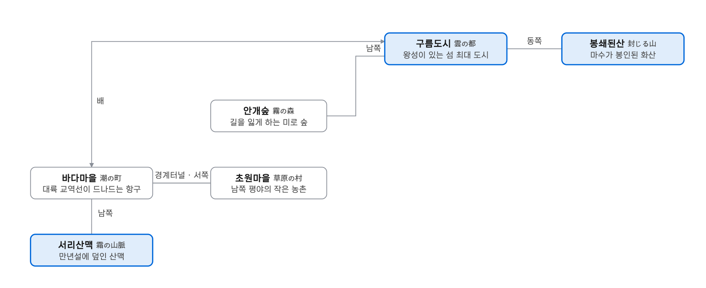
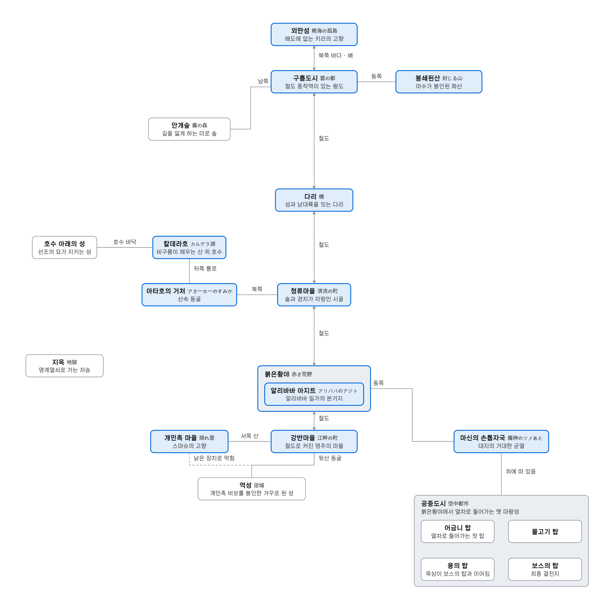
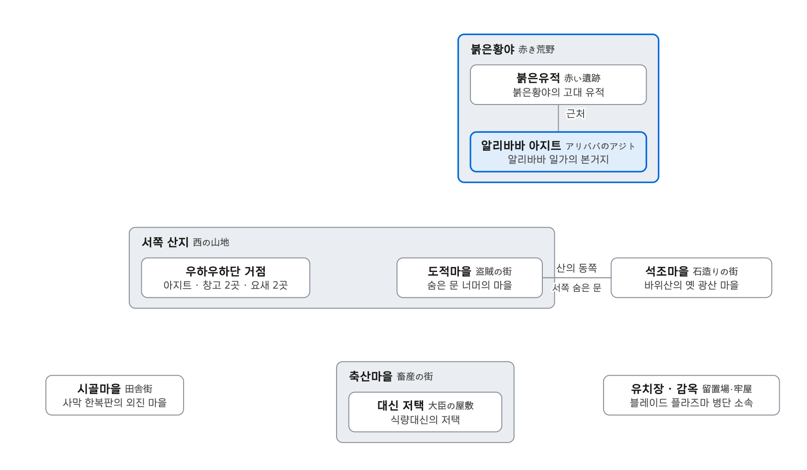
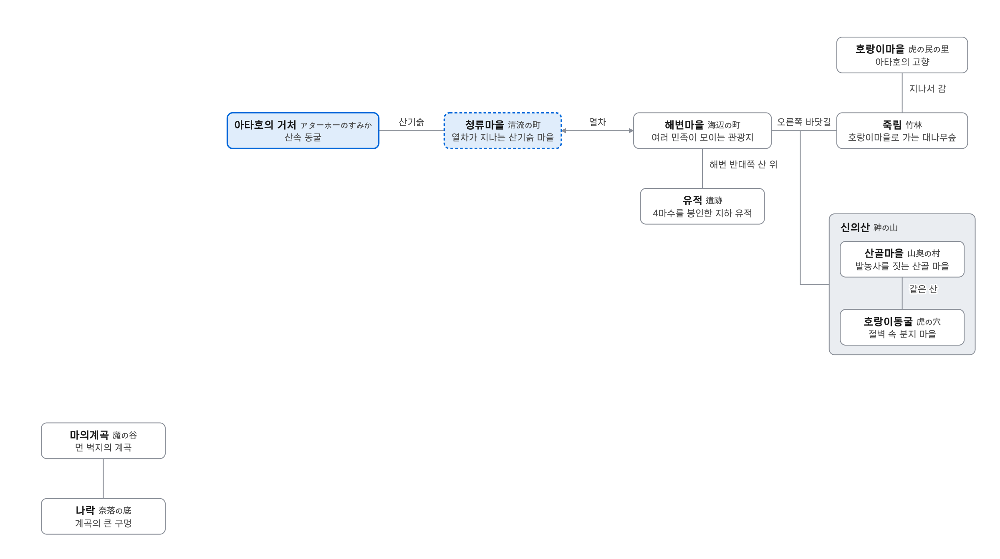
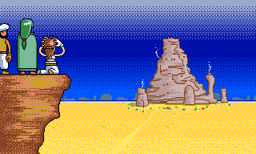

# 환세 시리즈 세계관의 마을과 도시

환세 시리즈는 작품마다 주인공이 바뀌지만 모두 같은 세계에서 벌어진다. 구름도시는 풍광전과 희담에 함께 나오고, 청류마을은 희담에 이어 취호전에도 이름이 나온다. 그런데 이 세계를 한눈에 보여주는 지도는 어디에도 없다. 매뉴얼에 실린 월드맵도 지명 하나 적히지 않은 손그림이다.

그래서 흩어진 지명을 모아 봤다. 희담·풍광전·쾌도전·포물장·취호전 5작의 게임 대사를 원문과 한글화 번역으로 전부 읽고 장소가 나오는 대목을 뽑았다. 희담 외전은 영상 자막, 쾌진극은 게임 텍스트로 따로 확인했다. 여기에 각 작품 매뉴얼, 디스크 스테이션 기사, 일본 공략 위키를 맞대 봤다. 근거가 대사에 직접 나오지 않고 정황으로 판단한 곳은 그렇다고 밝혀 두었다.

정리한 내용은 [환세 시리즈 지도](https://atah.io/viewer/map.html) 페이지로도 만들었다. 매뉴얼 월드맵 위에 게임 무대를 표시한 지도와, 작품별 장소 관계도를 함께 볼 수 있다. 이 글의 월드맵과 통합 관계도는 그 페이지를 그대로 넣은 것이다.

## 세계의 뼈대

환세 세계의 중심은 남북으로 길게 뻗은 대륙과, 그 북쪽에 다리로 이어진 **비의 섬**이다.

대륙을 세로로 꿰는 것이 **대륙횡단철도**다. 희담에서 「北と南の　ふたつの都をむすぶ　大陸横断鉄道」라고 소개되는 이 철도는 남쪽의 강반마을에서 출발해 붉은황야와 청류마을을 지나고, 섬과 대륙을 잇는 다리를 건너 구름도시에서 끝난다. 종점까지 일주일이 넘게 걸리는 긴 노선이다. 열차와 증기선, 총이 다니는 시대라서 희담 매뉴얼은 용사와 마법이 '과거의 유물'이 된 세상이라고 설명한다. 디스크 스테이션 기사는 이 분위기를 "스팀펑크풍"이라고 불렀다.

비의 섬은 원래 대륙과 붙어 있었다고 한다. 풍광전에 따르면 마수가 땅을 먹어 치우는 바람에 대륙에서 떨어져 섬이 되었다. 섬의 최대 도시이자 왕도가 구름도시다.

이 밖에 바다 건너 **동쪽 나라**(포물장의 무대)와, 해도에도 없는 **북쪽 바다의 외딴섬**(희담)이 있다.

세계관의 바탕에는 300년 전 이야기가 깔려 있다. 대륙의 마왕을 일곱 용사가 쓰러뜨렸고, 이들의 후손이 비보의 봉인을 지키는 일곱 민족이 되었다. 봉인 일족은 하나같이 인가를 떠나 숨어 산다. 대사로 확인되는 일족은 개민족(스마슈), 여우민족(화린), 호랑이민족(아타호), 붉은황야의 알리바바 일가, 비의 섬의 페톰 집안, 외딴섬의 키리 일족까지 여섯이다. 일곱 번째는 끝내 나오지 않는다.

## 작품별 무대

### 환세풍광전 — 비의 섬

풍광전은 처음부터 끝까지 비의 섬 안에서 진행된다. 남쪽 평야의 **초원마을**에서 출발해 서쪽 산을 뚫은 **경계터널**을 지나면 항구 **바다마을**이 나온다. 바다마을 남쪽으로는 만년설에 덮인 **서리산맥**이 있다. 바다마을에서 배를 타면 섬 북쪽 끝의 **구름도시**에 닿는다. 구름도시 남쪽이 결계로 둘러싸인 미로 숲 **안개숲**이고, 동쪽이 300년 전 마수를 봉인한 **봉쇄된산**이다.

매뉴얼은 마을에서 다른 마을로 가려면 반드시 던전을 지나야 하는 구조라고 설명한다. 초원마을에서 빼앗긴 식량이 안개숲으로 옮겨지는 사건처럼 섬 안의 마을들이 서로 얽혀 있다.

### 환세희담 — 대륙횡단철도

희담은 철도를 따라 대륙을 남쪽에서 북쪽으로 올라가는 이야기다.

- **강반마을**에서 시작한다. 철도 덕에 '돌과 철의 마을'로 커진 영주의 마을이다.
  - 서쪽 험한 산속에 스마슈의 고향 **개민족 마을**(은둔마을)이 있다.
  - 뒷산 동굴 안쪽에는 개민족의 비보를 봉인한 **역성**(거꾸로 된 성)이 있다. 개민족 마을 쪽에서도 이어지지만 그 길은 낡은 장치로 막혀 있다.
- 청류마을행 열차는 **붉은황야**를 지나다 알리바바 일가에게 통째로 털린다. 이들의 **아지트**는 선로 전환기로 철도와 이어진 수백 년 된 탑이다.
- **청류마을**은 술과 경치가 자랑인 시골이다.
  - 마을 북쪽 호랑이 바위 너머에 **아타호의 거처**가 있다.
  - 거처 뒤쪽 통로를 오르면 300년 동안 비구름이 채워 온 **칼데라호**가 나온다. 호수 아래의 성에는 호랑이민족 선조의 묘가 있고, 그 묘가 비보의 방을 지킨다.
- 다리를 건너면 섬의 **구름도시**다. 여왕 실라의 왕도이고 철도의 종점이다. 남쪽 안개숲과 동쪽 봉쇄된산은 풍광전과 같은 방향에 있다.
- 무대는 다시 넓어진다.
  - 구름도시에서 배를 타고 북쪽 바다의 **외딴섬**으로 간다.
  - 명계열쇠로 **지옥**에 다녀온다.
  - 붉은황야 동쪽의 거대한 균열 **마신의 손톱자국**에 이른다.
- 마지막 무대는 손톱자국 위에 떠 있는 **공중도시**다. 손톱자국에 있던 옛 마왕성이 떠올라 도시가 된 곳으로, 붉은황야에서 열차를 타고 들어간다.

### 환세쾌도전 — 이름 없는 나라

쾌도전의 무대는 성과 관병, 식량대신이 있는 나라인데 나라 이름이 나오지 않는다. 마을 이름도 전부 '축산마을(畜産の街)', '석조마을(石造りの街)'처럼 생김새를 그대로 부르는 식이다. 시리즈 공통 지명은 **붉은황야** 하나뿐이다.

희담에서 열차강도였던 알리바바 일가의 **아지트**가 이야기의 출발점이다. 페톰은 붉은황야의 **붉은유적** 안에서 "알리바바 씨 아지트는 이 근처였죠"라고 말한다. 여기서 사막 한복판의 **시골마을**, 돼지와 닭투성이인 **축산마을**, 우하우하도적단의 비밀 시설이 흩어진 **서쪽 산지**로 차례로 떠난다. 서쪽 산지의 동쪽에는 옛 광산 마을인 **석조마을**이 있고, 석조마을 서쪽 숨은 문 너머가 떨거지들이 모이는 **도적마을**이다.

방위가 대사에 나오는 건 서쪽 산지와 석조마을뿐이다. 나머지는 알리바바 아지트를 중심으로 각 마을에 다녀오는 전개라 서로의 위치 관계가 나오지 않는다.

### 환세포물장 — 동쪽 나라

포물장은 영주가 다스리는 에도풍의 동쪽 나라가 무대다. 화린이 여우민족 마을에서 배를 타고 건너온다. 서쪽 나라의 배가 드나들기 시작하면서 이 나라가 풍족해졌다는 설정이다.

마을 사이의 연결은 표지판과 주민 대사로 맞출 수 있다.

- **항구**에서 오른쪽으로 가면 **죽림**, 그 너머가 **여우마을**이다.
- 항구 왼쪽은 **해변**으로 이어진다.
- **성아랫마을**은 왼쪽으로 **성**, 오른쪽 위로 해변, 오른쪽 가운데로 산길이 갈라지는 거점이다.
- 산길 안쪽에 **온천마을**이 있다.
- 해변에서 거북을 타면 바닷속 **용궁성**에 간다.
- 마지막 무대는 영봉 **후지산**(不二山)의 5합목 수험장이다.

### 환세취호전 — 해변마을과 신의산

취호전은 희담과 같은 대륙에서 벌어진다. 아타호가 사는 산은 「山のふもとの　清流の町」, 즉 청류마을을 기슭에 둔 산이다. 희담에서 청류마을 북쪽에 있던 그 거처다. 다만 이번에는 청류마을에 들르지 않고 열차로 곧장 **해변마을**에 간다.

- **해변마을**은 호랑이·판다·개민족이 섞여 사는 관광지로, 이야기의 중심이다.
- 마을 반대쪽 뒷산에는 4마수를 봉인한 지하 **유적**이 있다.
- 오른쪽 바닷길로 **죽림**을 지나면 아타호의 고향 **호랑이마을**이다.
- 같은 바닷길로 **신의산**에 가면 산 아래 **산골마을**과, 절벽에 둘러싸인 분지 마을 **호랑이동굴**이 있다.
- 마지막 무대는 아주 먼 벽지인 **마의계곡**이다.

동쪽 섬나라에 있던 스마슈는 바다에 표류해 해변마을까지 떠내려온다. 해변마을과 동쪽 섬나라가 직접 이어지지는 않는다.

### 환세희담 외전 · 환세쾌진극

두 작품 모두 스마슈가 개민족 마을을 떠나 '전설의 책'을 찾는 이야기다. 위치 단서는 거의 없다. 희담 외전에서는 장로가 「書物は南西の島にある」라고 말한다. 개민족 마을에서 보면 남서쪽 바다의 섬이다. 쾌진극은 엔딩에서 "남쪽 탑"의 소문을 남기고 끝난다.

## 월드맵 위에 올려 보기

<iframe class="gensei-map" src="https://atah.io/viewer/map.html?world" style="width:100%;height:1200px;border:0" loading="lazy" title="환세 월드맵"></iframe>

환세 세계 지도로 남아 있는 건 희담 매뉴얼의 월드맵 하나다. 이 지도는 매뉴얼 여러 페이지에 배경으로 쓰인 손그림을 이어 붙여 복원한 것으로, 다른 시리즈가 나오기 전에 그려졌다. 지명 라벨도 없고 게임 안에서 쓰는 기준 지도도 아니다. 그래서 대사 속 방향과 지형 묘사로 실제 게임의 무대가 된 곳만 짚어 보았다. 정확한 위치라기보다 대략적인 위치 관계다.

- 지도에서 가로 눈금이 그어진 선은 철도, 매끈한 두 줄 선은 강으로 읽었다.
- 마커 문자는 남쪽 강반마을(A)에서 철도를 따라 북쪽으로 매겼다. 색은 확신도로, 빨강이 높음, 파랑이 중간, 회색이 낮음이다.
- **강반마을(A)과 개민족 마을(B)**: 강반마을은 이름 그대로 강가(江畔)로, 두 강과 철도가 만나는 곳이다. 개민족 마을은 그 서쪽 험한 산속이다.
- **붉은황야(C)와 알리바바 아지트(D)**: 철도 동쪽의 평원이다. 지도 속 탑 모양 바위는 쾌도전 엔딩 화면에 나오는 아지트와 생김새가 같다.
- **청류마을(E)**: 철도가 지나고, 칼데라호에서 흘러내린 강이 마을을 지나는 자리다.
- **아타호의 거처(F)와 칼데라호(G)**: 분화구 위 호수와 거기서 흘러내리는 폭포다. 대사의 "늘 비구름이 낀 칼데라호에서 떨어지는 폭포"와 그대로 맞는다.
- **다리(H)**: 섬과 대륙을 잇는 다리로, 철도가 해협을 건너는 유일한 곳이다.
- **마신의 손톱자국(K)**: 「大陸の赤き荒野の東にある巨大な亀裂」이라는 대사 그대로, 붉은황야 동쪽의 균열이다.

맞지 않는 부분도 있다. 대사는 북쪽을 바다에 둘러싸인 비의 섬으로, 구름도시를 섬 최북단의 철도 종점으로 그린다. 그런데 지도의 북쪽 땅은 섬처럼 보이지 않고, 종점 북쪽으로도 땅이 이어진다. 풍광전의 교역선이 대륙에 다녀오는 데 3개월이 걸린다는 대사도 지도의 좁은 해협과 거리감이 맞지 않는다. 지도가 후속작 설정보다 먼저 그려졌으니, 섬과 대륙의 구분은 나중에 설정이 달라진 것으로 보는 게 자연스럽다.

비의 섬 안쪽(바다마을, 초원마을 등)과 쾌도전·취호전의 마을들은 지도 위에 한 점을 고를 근거가 없어서 표시하지 않았다. 구름도시(I)·봉쇄된산(J)·서리산맥(L)은 지도에 표시했지만 확신도가 낮다. 서리산맥은 섬 서쪽의 뾰족한 설산 지대로 보았는데, "바다마을 남쪽"이라는 대사는 바다마을 위치를 정해야 확인할 수 있다.

## 작품을 잇는 고리

<iframe class="gensei-map" src="https://atah.io/viewer/map.html?place" style="width:100%;height:1700px;border:0" loading="lazy" title="환세 장소 관계도"></iframe>

작품마다 겹치는 장소를 하나로 합친 관계도다. 위의 작품 버튼으로 작품을 켜고 끌 수 있고, 더블클릭하면 그 작품만 남는다.

같은 장소와 사건이 작품을 넘나들며 언급된다. 그래서 각 작품의 무대를 한 세계로 이어 붙일 수 있다.

- **구름도시·안개숲·봉쇄된산**: 풍광전의 무대가 희담에 그대로 나온다. 희담에서 바자는 "5년 전 마수 쿠라우모노를 깨웠던 사건"을 언급한다. 풍광전의 사건이다.
- **청류마을과 아타호의 산**: 희담에서 청류마을 북쪽이던 아타호의 거처가, 취호전에서는 "산기슭에 청류마을이 있는 산"으로 나온다.
- **붉은황야**: 희담에서는 열차강도 알리바바 일가의 땅이고, 쾌도전에서는 붉은유적이 있는 황야다.
- **열차강도의 은퇴**: 희담에서 알리바바 일가가 마음을 고쳐먹은 뒤의 이야기다.
  - 쾌도전 감옥에서는 "열차강도를 그만둔 뒤로 감옥이 쓸쓸해졌다"는 말이 나온다.
  - 취호전 해변마을 관광객은 "요즘 열차강도가 전혀 안 나온다"고 한다.
- **여우민족 마을**: 포물장 오프닝은 "여우민족 마을은 전에 원숭이 군단에게 습격당했다(환세희담에서)"라고 직접 밝힌다.
- **동쪽 나라**: 희담에서 페톰이 죽마를 산 곳이고, 포물장의 무대이며, 취호전에서는 「東の島国」으로 불린다.

출시 순서는 풍광전(1994) → 희담(1995.4) → 쾌도전(1995.10) → 포물장(1996.4) → 쾌진극(1996.9) → 취호전(1997.3)이다. 작품 안의 시간으로는 풍광전이 희담보다 5년 앞선다. 디스크 스테이션 Vol.14는 취호전을 "이야기상으로는 포물장과 쾌도전 사이"라고 소개한다.

## 출처

- 게임 대사: 환세희담·풍광전·쾌도전·포물장·취호전 원문과 한글화 번역
- 매뉴얼·잡지: 희담·풍광전·쾌도전·포물장·쾌진극 매뉴얼, 디스크 스테이션 Vol.10·14·20·25, 컴파일 클럽 Vol.45·51
- 희담 외전 영상 자막, 쾌진극 게임 텍스트
- [환세희담 매뉴얼 번역 (atah.io)](https://atah.io/kitan_manual/)
- [환세희담 공략 (oysterbay.tistory.com)](https://oysterbay.tistory.com/100)
- [幻世喜譚 Disc Saga III - コンパイル@DiscStation wiki](https://w.atwiki.jp/discstation/pages/150.html)
- [幻世風狂伝 - コンパイル@DiscStation wiki](https://w.atwiki.jp/discstation/pages/140.html)
- [幻世捕物帳 - コンパイル@DiscStation wiki](https://w.atwiki.jp/discstation/pages/116.html)
- [幻世酔虎伝 - コンパイル@DiscStation wiki](https://w.atwiki.jp/discstation/pages/17.html)
- [幻世シリーズ - Wikipedia](https://ja.wikipedia.org/wiki/%E5%B9%BB%E4%B8%96%E3%82%B7%E3%83%AA%E3%83%BC%E3%82%BA)
